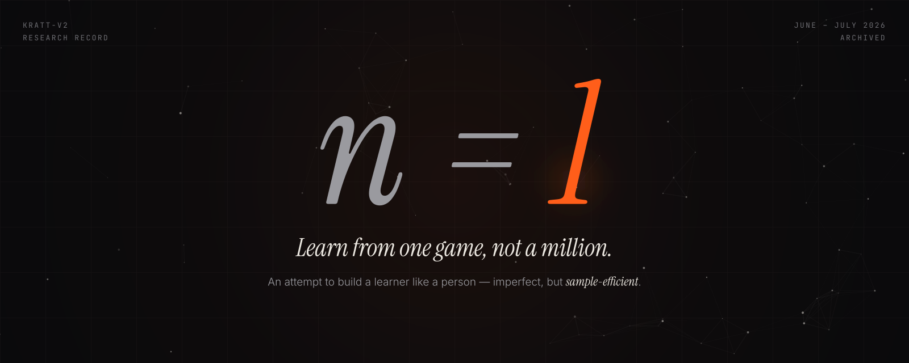
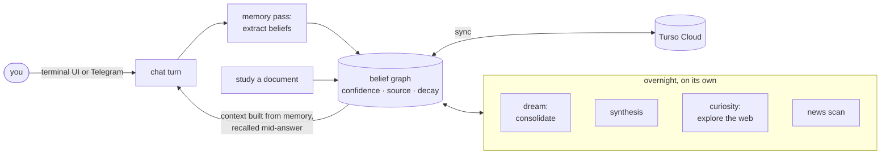
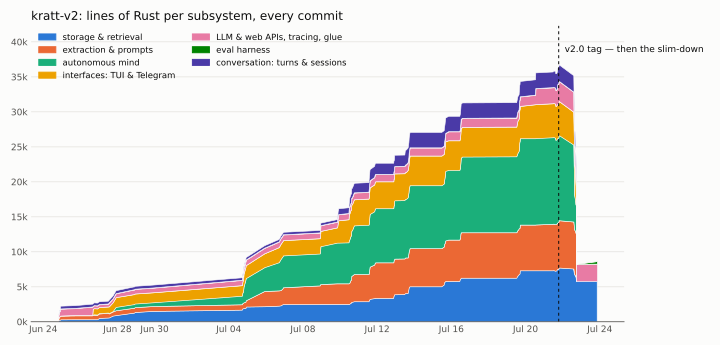
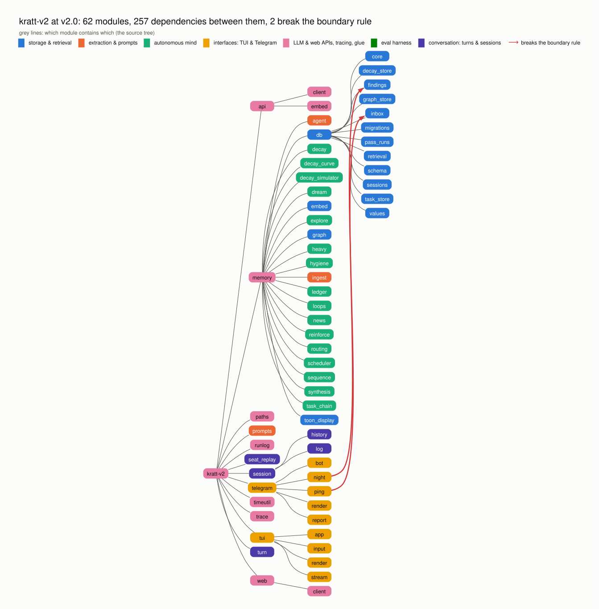
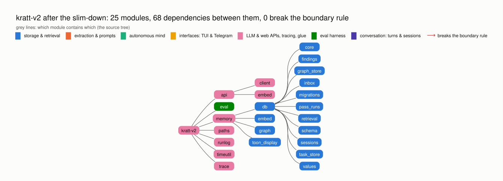
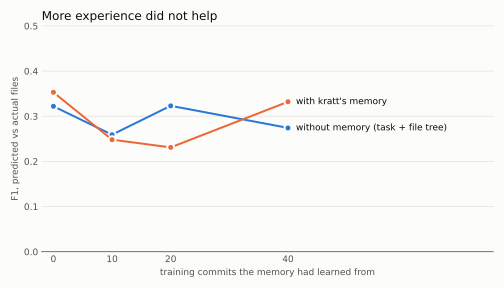

<p align="center"></p>

# kratt-v2 — archived

The second version of [**kratt**](https://github.com/chirbard/kratt), a personal research project. Built June 25 –
July 24, 2026; kept here as a record. It is not maintained.

**The bet.** Every AI lab is racing to build a perfect system — more
parameters, more compute, closer to flawless. kratt-v2 went the other way: it
tried to mimic a human learner — imperfect, but extraordinarily
sample-efficient. A person learning Go does not play a million games. They play
once, remember what happened, sleep on it, read a book, play again — and earn a
kind of wisdom no cold model has.

So kratt kept its experience as a graph of plain-language beliefs, each with a
confidence, a source and a decay: *edge-first*, readable by a person and
loadable by any base model without fine-tuning — a "knowledge crystal". Around
it grew the rest of a learner: it dreamed overnight to consolidate what it had
seen, explored out of curiosity, studied documents it was handed, and lived as
a daily chat companion in a terminal and on Telegram.

**The challenge to chat.** A chat model normally answers from its context
window: the conversation so far, growing until it is truncated or summarised.
kratt-v2 was *memory-first, not context-first* — every turn's context was
assembled from memory, with only a short window of recent turns carried
verbatim. Taken further, it started
each answer with only a small slice of memories and recalled more mid-answer,
the way a person suddenly remembers "wait — what camera does he shoot on?"
halfway through advice about colour grading.



It grew fast — and then it was cut down to a fifth of its size in two days:

<picture>
  <source media="(prefers-color-scheme: dark)" srcset="docs/code-size-dark.svg">
  
</picture>

**Built mostly by coding agents, under rules they could check.** `CLAUDE.md`
fixed the architecture — the core knows nothing of the interfaces, and the
interfaces know nothing of memory internals — and `cargo modules` made the
module graph visible enough to police it. Each chart is the source tree —
which module contains which — with the dependencies that break that rule drawn
on top in red:

<picture>
  <source media="(prefers-color-scheme: dark)" srcset="docs/modules-v2.0-dark.svg">
  
</picture>

At its peak — 62 modules, 257 dependencies, almost all written by agents — the
boundary held everywhere but two edges, both in the Telegram nightly report
reaching straight into the database. After the slim-down:

<picture>
  <source media="(prefers-color-scheme: dark)" srcset="docs/modules-slimmed-dark.svg">
  
</picture>

**Why it was cut:** the traces showed the foundation was bad. Extraction
produced junk — empty links, duplicate nodes, a cluster of confabulated beliefs
that fed itself — and dreaming *reinforced* it. Consolidating bad raw material
only turns noise into confident noise. So everything was tagged `v2.0` and the
autonomous layers were deleted, to rebuild extraction against objective tests.

**The test that ended it.** Sample efficiency, measured: could kratt learn how
change propagates in a codebase — *"remember the recipe, not the code"* — from
a few examples? Given a past commit's task in this repository's own history, it
predicted which files the commit touched: once from the task and the file tree
alone, once also with the memory it had built from earlier commits.

<picture>
  <source media="(prefers-color-scheme: dark)" srcset="docs/predict-f1-dark.svg">
  
</picture>

The memory brought no measurable improvement over the plain file tree, and more
experience did not help. Together with
[published work](https://arxiv.org/abs/2606.29914) finding plain retrieval on
par with elaborate memory systems at a fraction of the cost, that closed the
thesis. The successor stopped trying to build a mind and became a reader over
notes a person writes — one that never writes to them.

**Browsing it:** the tag [`v2.0`](../../tree/v2.0) is the full system at its
peak; `main` is the slimmed core plus the eval harness. Charts are drawn from
the git history by `docs/charts.py` and `docs/modules.py`. The notes below are the original README
and describe the system at `v2.0`.

---

# kratt-v2

## Turso Cloud sync (backup + multi-machine)

The database (graph, ledger, positions, history) lives in `kratt-data/`. With
Turso Cloud credentials set, the app runs on a synced local file
(`kratt-data/kratt-synced.db`): reads and writes stay local, changes push to
the cloud after every background pass (memory agent, dream, explore, embed)
and on app exit, and the app pulls on startup. Without credentials it runs
fully local on `kratt-data/kratt.db`, unchanged.

One-time setup:

```sh
# install the Turso CLI and sign up (free plan: 5GB, 3GB sync/month)
curl -sSfL https://get.tur.so/install.sh | bash
turso auth signup   # or: turso auth login

turso db create kratt
turso db show kratt --url          # -> TURSO_DATABASE_URL
turso db tokens create kratt       # -> TURSO_AUTH_TOKEN
```

Put both in `.env` (loaded via dotenvy at startup):

```sh
TURSO_DATABASE_URL=libsql://kratt-<org>.turso.io
TURSO_AUTH_TOKEN=<token>
```

First run on this machine: the synced database starts empty, the legacy
`kratt.db` is detected and copied over automatically (check the run log for
`[sync] legacy migration done`), then pushed to the cloud. On a second
machine, just set the same two variables — the local file bootstraps from the
cloud on first start. The legacy `kratt.db` is never modified; it stays as a
local fallback.

Notes:

- First synced start needs network (bootstrap); after that the app works
  offline and syncs on the next opportunity.
- Conflict resolution is "last push wins" per statement — fine for one person
  alternating between machines; don't run heavy write passes on both
  machines simultaneously.
- Human review: the Turso Cloud dashboard (app.turso.tech) has a per-database
  SQL shell and data browser; the local inspector
  (`cargo run --bin inspector`, http://127.0.0.1:7070) still works and reads
  whichever file the app uses.
- Message full-text search degrades in synced mode: the cloud server cannot
  parse the `CREATE INDEX … USING fts` DDL (pushes carrying it fail, and pulls
  can drop the local index record), so the FTS index is created in local mode
  only and synced-mode history search falls back to LIKE.
- Sync failures show as a red `⚠ sync` warning in the status line; press S to
  retry. The warning clears on the next successful sync.

## Telegram gateway (headless daily driver)

The same binary runs headless behind Telegram: `cargo run --release -- --telegram`
long-polls the Bot API and answers through the exact chat-turn pipeline the TUI
uses (memory injection, tool loop, memory pass after every turn). No inbound
port needed — works behind NAT.

Setup:

1. Create a bot with [@BotFather](https://t.me/BotFather) → token.
2. Get your numeric user id (message [@userinfobot](https://t.me/userinfobot)).
3. Put both in `.env` (see `.env.example`):

```sh
TELEGRAM_BOT_TOKEN=123456:ABC-...
TELEGRAM_USER_ID=123456789
```

4. Run `cargo run --release -- --telegram` — the console prints
   `kratt telegram gateway ready` when polling starts.

Behavior and rules:

- **Allowlist**: only `TELEGRAM_USER_ID` is answered; everyone else is dropped
  with a log line. This is the entire security model — set it correctly.
- **Sessions are per calendar day** (`tg-YYYY-MM-DD`), unlike the TUI's
  session-per-launch.
- Turns are strictly sequential: answer → memory pass → next message. Messages
  sent while a turn (or the daemon) is busy queue on Telegram's side and are
  picked up in order; you'll see "typing…" the whole time a turn is running.
- Answers are rendered to Telegram HTML (headers→bold, bullets, code blocks;
  tables land as monospace blocks). The system prompt tells the model it is on
  a phone, so it avoids tables in the first place.
- Ctrl-C / SIGTERM shuts down gracefully (finishes the in-flight turn and
  memory pass, syncs, exits — the console says so). A second Ctrl-C force-quits.
- Observability = the same run logs: `kratt-data/logs/kratt-YYYY-MM-DD.log`
  (gateway lines are tagged `[tg]`).

Development without touching the live brain — two axes, both required:

```sh
# separate data dir AND a separate dev bot token
KRATT_DATA_DIR=kratt-data-dev TELEGRAM_BOT_TOKEN=<dev bot> TELEGRAM_USER_ID=<you> \
  cargo run -- --telegram
```

Never run two pollers on one token (they fight over `getUpdates`), and never
run the TUI and the daemon against the same data dir at the same time (the
write lock is in-process only). A custom `KRATT_DATA_DIR` automatically
disables Turso cloud sync so dev runs can never write into the live cloud
database (`KRATT_SYNC=1` opts back in deliberately).

Home-server deploy: build with `--release`, run under systemd with
`Restart=on-failure`, `.env` in the working directory, `KRATT_DATA_DIR` unset
(live data root + Turso sync as backup). Deploys lose nothing: Telegram queues
messages while the daemon is down and long polling picks them up on restart.

## using cargo-modules to see boundary violations

for LLM (90% of the time codebase-memory-mcp does the job good enough)

```sh
cargo modules structure
```

DOT graph for human

```sh
cargo modules dependencies --no-externs --no-fns --no-sysroot --no-traits --no-types --no-uses > mods.dot
```
